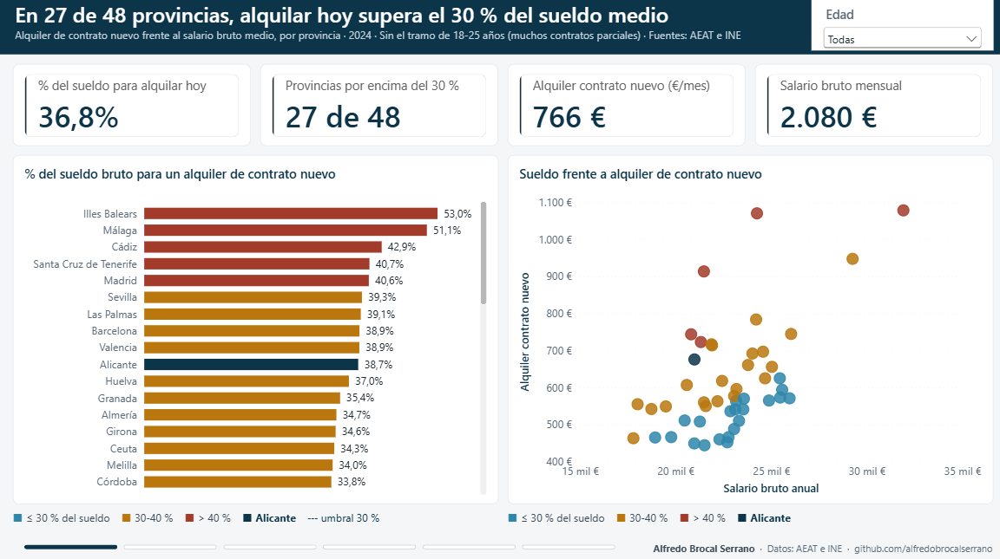

# ¿Se puede vivir de alquiler con un sueldo español?

**En 27 de las 48 provincias analizadas, alquilar hoy una vivienda supera el 30 % del sueldo bruto medio.**

Informe de Power BI que cruza el alquiler declarado en el IRPF con el salario medio por provincia (2024), con foco en Alicante.



## Hallazgos principales

- Un alquiler de **contrato nuevo** cuesta de media **766 €/mes** en España: el **36,8 %** del salario bruto medio.
- Quien firma hoy paga un **11 % más** que la media de todos los contratos (en Alicante, un 17 % más).
- **Baleares (53 %) y Málaga (51 %)** son las provincias donde más pesa el alquiler.
- **Alicante** es la **10.ª de 48**, con un salario medio un **16 % inferior** al de España.
- Entre 2015 y 2024 el índice de alquiler del INE sube menos que el salario medio: mide sobre todo contratos ya firmados. El problema lo sufre quien busca piso hoy.

## Páginas del informe

| Página | Qué muestra |
|---|---|
| Resumen | % del sueldo que cuesta un alquiler nuevo por provincia, con filtro por edad |
| Provincias | Sobrecoste del contrato nuevo frente a la media, €/m² y superficie |
| ¿Dónde puedo vivir? | Parámetro interactivo: introduce tu sueldo y ve en qué provincias es asumible |
| Evolución 2015-2024 | Índice de alquiler del INE frente al salario medio (base 2015 = 100) |
| Foco Alicante | Alicante frente a España y sus 26 municipios de más de 20.000 habitantes |
| Metodología | Fuentes, cálculos y limitaciones |

## Fuentes

- **Agencia Tributaria (AEAT)**: *Mercado de trabajo y pensiones en las fuentes tributarias* 2015-2024 (salarios por provincia y edad).
- **Agencia Tributaria (AEAT)**: *Estadística de viviendas declaradas en el IRPF* 2024 (alquiler medio, contratos nuevos, €/m²).
- **INE**: Índice de Precios de Vivienda en Alquiler (IPVA), base 2015.

## Cómo está construido

```
raw/                   Datos extraídos de las tablas de la AEAT
59059.csv              IPVA provincial del INE
preparar_datos.py      Limpieza y modelo en estrella  ->  datos_limpios/
construir_modelo.py    Modelo semántico (TMDL): tipos, relaciones y medidas DAX
generar_reporte.py     Primera versión de las páginas (PBIR); el informe final incluye ajustes hechos en Power BI Desktop
alquiler-vs-sueldo.pbip                 Proyecto de Power BI
alquiler-vs-sueldo.SemanticModel/       Modelo: 12 tablas, 39 medidas DAX
alquiler-vs-sueldo.Report/              Informe: 6 páginas y tema propio
```

- **Modelo en estrella**: dimensiones de provincia, año y tramo de edad; tablas de hechos por provincia y municipio; totales de España en tablas aparte.
- **DAX**: medias ponderadas por viviendas y asalariados, rankings, parámetro "¿y si…?" para el sueldo y colores condicionales.
- **Diseño**: paleta apta para daltonismo, texto alternativo en todos los visuales y tema JSON propio.

## Cómo abrirlo

1. Clona el repositorio y abre `alquiler-vs-sueldo.pbip` con Power BI Desktop.
2. En *Transformar datos → Editar parámetros*, cambia `RutaDatos` por la ruta de tu carpeta `datos_limpios\`.
3. Pulsa **Actualizar**.

Para regenerar los datos: `python preparar_datos.py` (requiere pandas).

## Limitaciones

- No incluye País Vasco ni Navarra (haciendas forales).
- Salario **bruto** medio, que incluye a quien trabajó solo parte del año; por eso se excluye el tramo de 18 a 25 años. El umbral del 30 % suele aplicarse al sueldo neto, así que el esfuerzo real es mayor.
- Alquileres declarados en el IRPF (medias), no precios de anuncio.

---

**Alfredo Brocal Serrano** · Data Scientist & Analyst · [LinkedIn](https://www.linkedin.com/in/alfredo-brocal-serrano-a0b1a73ab/) · [Portfolio](https://portfolio-alfredo-brocal.vercel.app)
